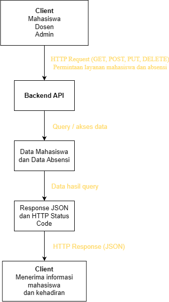

# Tugas 1 – Analisis dan Desain API

**Nama:** Disti Setiawati  
**NIM:** 240160221009  
**Kelas:** SI-VB

## 1. Deskripsi Sistem

Sistem Informasi Absensi Perkuliahan Mahasiswa merupakan sistem yang digunakan untuk membantu proses pencatatan dan pengelolaan kehadiran mahasiswa dalam kegiatan perkuliahan. Sistem ini menyimpan data mahasiswa serta catatan absensi berdasarkan mata kuliah, pertemuan, dan tanggal perkuliahan. Pengguna sistem terdiri dari admin, dosen, dan mahasiswa. Admin dapat mengelola data mahasiswa, dosen dapat mencatat dan mengelola absensi perkuliahan, sedangkan mahasiswa dapat melihat informasi kehadirannya.

## 2. Resource dan Endpoint

### Resource: Mahasiswa

| No | Operasi | Method | Endpoint | Request Body | Response | Status |
|---|---|---|---|---|---|---|
| 1 | Menampilkan semua mahasiswa | GET | `/mahasiswa` | - | Daftar data mahasiswa | 200 / 500 |
| 2 | Menampilkan mahasiswa berdasarkan ID | GET | `/mahasiswa/1` | - | Detail mahasiswa | 200 / 404 |
| 3 | Menambahkan mahasiswa | POST | `/mahasiswa` | `nim, nama, prodi, semester` | Data mahasiswa yang ditambahkan | 201 / 400 |
| 4 | Mengubah data mahasiswa | PUT | `/mahasiswa/1` | `nama, prodi, semester` | Data mahasiswa yang diperbarui | 200 / 400 / 404 |

### Resource: Absensi

| No | Operasi | Method | Endpoint | Request Body | Response | Status |
|---|---|---|---|---|---|---|
| 5 | Menampilkan semua data absensi | GET | `/absensi` | - | Daftar data absensi | 200 / 500 |
| 6 | Menampilkan absensi berdasarkan ID | GET | `/absensi/1` | - | Detail data absensi | 200 / 404 |
| 7 | Menambahkan data absensi | POST | `/absensi` | `mahasiswaId, mataKuliah, pertemuan, tanggal, status` | Data absensi yang ditambahkan | 201 / 400 |
| 8 | Menghapus data absensi | DELETE | `/absensi/1` | - | Pesan dan data berhasil dihapus | 200 / 404 |

## 3. Contoh JSON

### 3.1 Resource Mahasiswa

**Request Body**

```json
{
  "nim": "240160221009",
  "nama": "Disti Setiawati",
  "prodi": "Sistem Informasi",
  "semester": 5
}
```

**Response Body**

```json
{
  "success": true,
  "data": {
    "id": 1,
    "nim": "240160221009",
    "nama": "Disti Setiawati",
    "prodi": "Sistem Informasi",
    "semester": 5
  }
}
```

### 3.2 Resource Absensi

**Request Body**

```json
{
  "mahasiswaId": 1,
  "mataKuliah": "Pemrograman Web Backend",
  "pertemuan": 1,
  "tanggal": "2026-09-29",
  "status": "hadir"
}
```

**Response Body**

```json
{
  "success": true,
  "data": {
    "id": 1,
    "mahasiswaId": 1,
    "mataKuliah": "Pemrograman Web Backend",
    "pertemuan": 1,
    "tanggal": "2026-09-29",
    "status": "hadir"
  }
}
```

## 4. Skenario Request–Response

### Skenario 1 – Menampilkan Data Mahasiswa

**Request**
- Method: GET
- Endpoint: `/mahasiswa`
- Request Body: Tidak ada

**Response**
- Status: 200 OK

```json
{
  "success": true,
  "total": 1,
  "data": [
    {
      "id": 1,
      "nim": "240160221009",
      "nama": "Disti Setiawati",
      "prodi": "Sistem Informasi",
      "semester": 5
    }
  ]
}
```

### Skenario 2 – Menambahkan Data Absensi

**Request**
- Method: POST
- Endpoint: `/absensi`

Request Body:

```json
{
  "mahasiswaId": 1,
  "mataKuliah": "Pemrograman Web Backend",
  "pertemuan": 1,
  "tanggal": "2026-09-29",
  "status": "hadir"
}
```

**Response**
- Status: 201 Created

```json
{
  "success": true,
  "message": "Data absensi berhasil ditambahkan",
  "data": {
    "id": 1,
    "mahasiswaId": 1,
    "mataKuliah": "Pemrograman Web Backend",
    "pertemuan": 1,
    "tanggal": "2026-09-29",
    "status": "hadir"
  }
}
```

### Skenario 3 – Data Absensi Tidak Ditemukan

**Request**
- Method: GET
- Endpoint: `/absensi/99`
- Request Body: Tidak ada

**Response**
- Status: 404 Not Found

```json
{
  "success": false,
  "message": "Data absensi tidak ditemukan"
}
```

## 5. Diagram Arsitektur

Berikut merupakan gambaran arsitektur Sistem Informasi Absensi Perkuliahan Mahasiswa.


