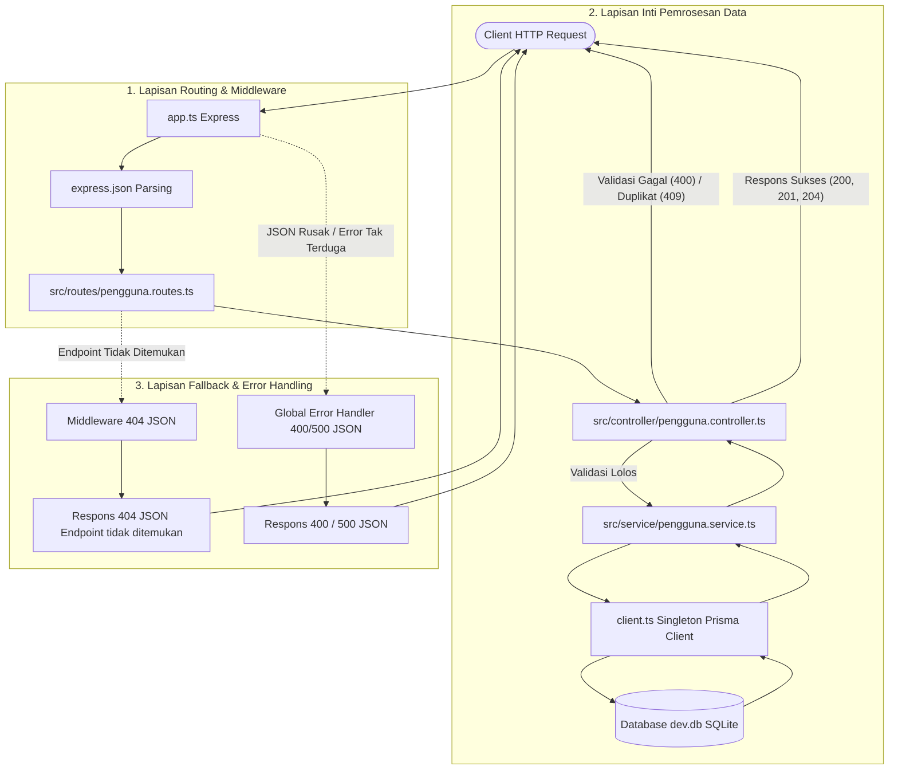

# Tugas 5 – CRUD REST API dengan Pola Service dan Controller

## 1. Deskripsi

Tugas ini merupakan pengembangan dari Tugas 4 (Pertemuan 06). Pada tugas ini, REST API untuk resource **Pengguna** dibangun kembali menggunakan **Express.js 5**, **Prisma ORM 7**, dan database **SQLite** dengan menerapkan **Layered Architecture (Arsitektur Berlapis)** melalui pemisahan tanggung jawab yang jelas antara **Route**, **Controller**, dan **Service**.

Data pengguna disimpan secara permanen di dalam database SQLite lokal sehingga data tetap tersimpan saat server dihentikan atau dijalankan ulang.

---

## 2. Identitas Mahasiswa

* **Nama:** Disti Setiawati
* **NIM:** 240160221009
* **Kelas:** SI - VB
* **Mata Kuliah:** Pemrograman Backend

---

## 3. Teknologi yang Digunakan

* **Node.js:** 24.15.0 (menggunakan fitur eksekusi bawaan `--experimental-strip-types`)
* **Framework:** Express.js 5.3.0
* **ORM:** Prisma ORM 7.10.1 & `@prisma/client` 7.10.1
* **Database Driver Adapter:** `@prisma/adapter-better-sqlite3` 7.10.1
* **Database:** SQLite
* **Bahasa:** TypeScript

---

## 4. Struktur Folder Project

```text
Tugas-5/
├── prisma/
│   ├── generated/                     # Berkas Prisma Client hasil generate
│   ├── migrations/
│   │   └── 20261102022108_init/       # Berkas migrasi skema tabel Pengguna
│   │       └── migration.sql
│   │   └── migration_lock.toml
│   └── schema.prisma                  # Definisi skema model database
├── src/
│   ├── controller/
│   │   └── pengguna.controller.ts     # Menangani request, validasi tipe data, status code, & respons
│   ├── routes/
│   │   └── pengguna.routes.ts         # Memetakan endpoint URL ke fungsi controller
│   └── service/
│       └── pengguna.service.ts        # Murni menjalankan operasi query database Prisma
├── .env                               # Konfigurasi environment lokal (diabaikan oleh git)
├── .env.example                       # Template environment variable
├── app.ts                             # Konfigurasi middleware Express, rute utama, 404, & error handler
├── client.ts                          # Inisialisasi singleton Prisma Client dengan adapter SQLite
├── package.json                       # Konfigurasi project, dependencies, dan scripts
├── package-lock.json                  # Kunci versi dependensi
├── prisma.config.ts                   # Konfigurasi datasource dan migrasi Prisma ORM 7
├── README.md                          # Dokumentasi lengkap tugas
└── server.ts                          # Entry point listener server HTTP & graceful shutdown
```

---

## 5. Pola Arsitektur Berlapis (Routes – Controller – Service)

Aplikasi ini membagi tugas ke dalam lapisan-lapisan yang memiliki tanggung jawab spesifik:



### Penjelasan Tanggung Jawab Tiap Komponen:

| Komponen | Berkas | Peran dan Tanggung Jawab |
|---|---|---|
| **Route** | `src/routes/pengguna.routes.ts` | Murni menghubungkan metode HTTP (`GET`, `POST`, `PATCH`, `DELETE`) dan path URL ke fungsi handler controller yang sesuai. Tidak memproses logika bisnis maupun validasi data. |
| **Controller** | `src/controller/pengguna.controller.ts` | Menerima parameter URL dan body request, melakukan gerbang validasi (`typeof === "string"`, pemotongan spasi `trim()`, regex email, penolakan field terlarang pada PATCH), menentukan status code HTTP (200, 201, 204, 400, 404, 409), serta menyusun respons JSON seragam dengan format `details`. |
| **Service** | `src/service/pengguna.service.ts` | Murni mengeksekusi operasi database menggunakan Prisma ORM (`findMany`, `findUnique`, `create`, `update`, `delete`). Service terisolasi dari objek Express (`req` / `res`), sehingga fokus pada interaksi database. |
| **Client** | `client.ts` | Menginisialisasi instance singleton Prisma Client yang dikombinasikan dengan adapter `@prisma/adapter-better-sqlite3`. |
| **Middleware 404** | `app.ts` | Menangkap seluruh permintaan dengan rute atau metode HTTP yang tidak terdaftar, lalu mengembalikan respons standar `404 Not Found` berformat JSON seragam. |
| **Global Error Handler** | `app.ts` | Middleware penanganan error terpusat (menggunakan 4 parameter `err, req, res, next`) yang menangani error tidak terduga (500) dan error parsing format JSON request yang rusak (400) dalam bentuk JSON seragam. |

---

## 6. Model Database

Model database didefinisikan pada file `prisma/schema.prisma`:

```prisma
model Pengguna {
  id    Int    @id @default(autoincrement())
  nim   String @unique
  nama  String
  email String @unique
  role  String
}
```

* `id`: Primary key bertipe integer yang nilainya diisi secara otomatis (*auto-increment*).
* `nim`: Nomor Induk Mahasiswa bertipe string dan harus unik (`@unique`).
* `nama`: Nama lengkap pengguna bertipe string.
* `email`: Alamat surel pengguna bertipe string dan harus unik (`@unique`).
* `role`: Peran pengguna di dalam sistem (misalnya: `mahasiswa`, `asisten`, `admin`).

---

## 7. Langkah Instalasi dan Menjalankan Server

### 1. Instalasi Dependency
Jalankan perintah instalasi pustaka yang dibutuhkan:
```bash
npm install
```

### 2. Konfigurasi Environment
Salin template konfigurasi dari `.env.example` ke `.env`:
```env
DATABASE_URL="file:./prisma/dev.db"
PORT=3008
```

### 3. Menjalankan Migrasi Database
Jalankan migrasi untuk memastikan tabel `Pengguna` telah dibuat pada SQLite:
```bash
npx prisma migrate dev --name init
```

### 4. Menghasilkan Prisma Client
Generate modul Prisma Client TypeScript lokal:
```bash
npx prisma generate
```

### 5. Menjalankan Server Aplikasi
Jalankan server menggunakan skrip npm yang telah dikonfigurasi:
```bash
npm run dev
```
Atau dapat dijalankan langsung menggunakan Node.js:
```bash
node --experimental-strip-types server.ts
```

Apabila berhasil, server aktif dan siap melayani permintaan pada port `3008`:
```text
CRUD REST API berjalan di http://localhost:3008
```

---

## 8. Daftar Endpoint API

| No | Method | Endpoint | Fungsi | Status Sukses |
|---|---|---|---|---|
| 1 | GET | `/` | Menampilkan informasi API dan daftar endpoint yang tersedia | 200 OK |
| 2 | GET | `/pengguna` | Mengambil seluruh data pengguna yang tersimpan di database | 200 OK |
| 3 | GET | `/pengguna/:nim` | Mengambil detail satu data pengguna berdasarkan NIM | 200 OK |
| 4 | POST | `/pengguna` | Menambahkan data pengguna baru ke database | 201 Created |
| 5 | PATCH | `/pengguna/:nim` | Memperbarui sebagian data pengguna berdasarkan NIM | 200 OK |
| 6 | DELETE | `/pengguna/:nim` | Menghapus satu data pengguna berdasarkan NIM | 204 No Content |

---

## 9. Aturan Validasi dan Status Code

### Aturan Validasi Input:
* **Gerbang `typeof`:** Seluruh field input (`nim`, `nama`, `email`, `role`) wajib diperiksa bertipe `string` dan tidak boleh berupa string kosong setelah spasi dibersihkan (`trim()`).
* **Format Email:** Email divalidasi dengan pola ekspresi reguler `/^[^\s@]+@[^\s@]+\.[^\s@]+$/`.
* **POST `/pengguna`:** Seluruh field (`nim`, `nama`, `email`, `role`) wajib diisi. Apabila validasi gagal, API mengembalikan respons `400 Bad Request` dengan daftar pesan error pada field `details`. Apabila NIM atau email sudah terdaftar di database, dikembalikan respons `409 Conflict`.
* **PATCH `/pengguna/:nim`:** Hanya field `nama`, `email`, dan `role` yang diizinkan untuk diperbarui. Minimal satu field valid harus dikirim. Pengiriman field terlarang (seperti `nim` atau `id`) akan ditolak dengan respons `400 Bad Request`.

### Standar Status Code HTTP:
| Status Code | Kondisi Penggunaan |
|---|---|
| **200 OK** | Permintaan `GET` atau `PATCH` berhasil dieksekusi. |
| **201 Created** | Data pengguna baru berhasil disimpan ke database (`POST`). |
| **204 No Content** | Data pengguna berhasil dihapus tanpa response body (`DELETE`). |
| **400 Bad Request** | Validasi input gagal, format JSON request rusak, atau field terlarang dikirim. |
| **404 Not Found** | Data pengguna atau endpoint rute tidak ditemukan. |
| **409 Conflict** | Duplikasi data unik (NIM atau Email sudah terdaftar di database — Prisma `P2002`). |
| **500 Internal Server Error** | Terjadi kesalahan yang tidak terduga pada server. |

---

## 10. Contoh Request cURL dan Respons

*(Seluruh perintah cURL di bawah ini menggunakan URL biasa dalam format teks, sehingga dapat langsung disalin ke terminal).*

### 1. Menampilkan Info API
```bash
curl http://localhost:3008/
```
Respons (200 OK):
```json
{
  "success": true,
  "message": "CRUD REST API Pengguna — Tugas 5 (Arsitektur Service & Controller)",
  "endpoints": [
    "GET    /pengguna",
    "GET    /pengguna/:nim",
    "POST   /pengguna",
    "PATCH  /pengguna/:nim",
    "DELETE /pengguna/:nim"
  ]
}
```

### 2. Mengambil Semua Pengguna
```bash
curl http://localhost:3008/pengguna
```
Respons (200 OK):
```json
{
  "success": true,
  "message": "Data pengguna berhasil diambil",
  "data": [
    {
      "id": 4,
      "nim": "240160221009",
      "nama": "Disti Setiawati",
      "email": "disti.tugas4@example.com",
      "role": "mahasiswa"
    }
  ]
}
```

### 3. Mengambil Detail Pengguna Berdasarkan NIM
```bash
curl http://localhost:3008/pengguna/240160221009
```
Respons (200 OK):
```json
{
  "success": true,
  "message": "Detail pengguna berhasil diambil",
  "data": {
    "id": 4,
    "nim": "240160221009",
    "nama": "Disti Setiawati",
    "email": "disti.tugas4@example.com",
    "role": "mahasiswa"
  }
}
```

### 4. Menambahkan Pengguna Baru
```bash
curl -X POST http://localhost:3008/pengguna -H "Content-Type: application/json" -d "{\"nim\":\"240160221010\",\"nama\":\"Ahmad Fauzi\",\"email\":\"ahmad.fauzi@example.com\",\"role\":\"mahasiswa\"}"
```
Respons (201 Created):
```json
{
  "success": true,
  "message": "Pengguna berhasil dibuat",
  "data": {
    "id": 5,
    "nim": "240160221010",
    "nama": "Ahmad Fauzi",
    "email": "ahmad.fauzi@example.com",
    "role": "mahasiswa"
  }
}
```

### 5. Uji Duplikasi NIM atau Email (409 Conflict)
```bash
curl -X POST http://localhost:3008/pengguna -H "Content-Type: application/json" -d "{\"nim\":\"240160221009\",\"nama\":\"Duplikat\",\"email\":\"disti.tugas4@example.com\",\"role\":\"mahasiswa\"}"
```
Respons (409 Conflict):
```json
{
  "success": false,
  "message": "NIM atau email sudah terdaftar"
}
```

### 6. Uji Validasi Data Kosong atau Format Salah (400 Bad Request)
```bash
curl -X POST http://localhost:3008/pengguna -H "Content-Type: application/json" -d "{\"nim\":\"\",\"nama\":\"\",\"email\":\"bukan-email\",\"role\":\"\"}"
```
Respons (400 Bad Request):
```json
{
  "success": false,
  "message": "Data pengguna tidak valid",
  "details": [
    "Field nim wajib diisi",
    "Field nama wajib diisi",
    "Field email harus berformat email valid",
    "Field role wajib diisi"
  ]
}
```

### 7. Memperbarui Data Pengguna (PATCH)
```bash
curl -X PATCH http://localhost:3008/pengguna/240160221010 -H "Content-Type: application/json" -d "{\"role\":\"asisten\"}"
```
Respons (200 OK):
```json
{
  "success": true,
  "message": "Data pengguna berhasil diperbarui",
  "data": {
    "id": 5,
    "nim": "240160221010",
    "nama": "Ahmad Fauzi",
    "email": "ahmad.fauzi@example.com",
    "role": "asisten"
  }
}
```

### 8. Menghapus Data Pengguna (DELETE)
```bash
curl -X DELETE http://localhost:3008/pengguna/240160221010
```
Respons: **204 No Content** (tanpa response body).

### 9. Uji Mengakses Pengguna yang Tidak Ada (404 Not Found)
```bash
curl http://localhost:3008/pengguna/999999
```
Respons (404 Not Found):
```json
{
  "success": false,
  "message": "Pengguna tidak ditemukan"
}
```

### 10. Uji Endpoint Tidak Dikenal (404 Not Found)
```bash
curl http://localhost:3008/rute-salah
```
Respons (404 Not Found):
```json
{
  "success": false,
  "message": "Endpoint tidak ditemukan"
}
```

---

## 11. Kesimpulan

Pada Tugas 5 ini, arsitektur REST API berhasil diimplementasikan secara solid:
1. **Pemisahan Peran:** Controller hanya berfokus pada protokol HTTP, validasi gerbang `typeof`, dan penentuan status respons (menyertakan array `details` saat validasi gagal). Sementara itu, Service menangani interaksi langsung dengan database melalui Prisma ORM.
2. **Kualitas dan Ketahanan Kode:** Penanganan error duplikasi Prisma `P2002` (409 Conflict), pencegahan manipulasi field terlarang, middleware 404 JSON, dan global error handler JSON berhasil diimplementasikan secara komprehensif.
3. **Persistensi Data:** Data tetap tersimpan aman di database SQLite lokal dan koneksi ditutup secara bersih (*graceful shutdown*) saat server dihentikan.
