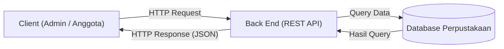

# TUGAS 1 — ANALISIS & DESAIN API

| Identitas | Keterangan |
|:---|:---|
| **Nama** | Indri Rahmalia |
| **NIM** | 240160221017 |
| **Kelas** | SI-VB |
| **Domain** | Perpustakaan |

---

## 1. Deskripsi Sistem

Sistem Informasi Perpustakaan merupakan aplikasi yang digunakan
untuk mengelola data buku, anggota, serta transaksi peminjaman dan
pengembalian buku.

Sistem ini memiliki dua jenis pengguna, yaitu admin/petugas
perpustakaan dan anggota perpustakaan (mahasiswa). Admin dapat
menambahkan, mengubah, menghapus, serta melihat data buku dan
anggota. Sementara itu, anggota dapat melihat daftar buku,
mencari buku, melakukan peminjaman, dan pengembalian buku.

Sistem menggunakan API sebagai penghubung antara aplikasi
(client), back end, dan database agar pertukaran data dapat
berjalan dengan baik.

---

## 2. Diagram Arsitektur

Alur komunikasi sistem:

Client → HTTP Request → Back End → Database
→ HTTP Response → Client

### Kode Mermaid

