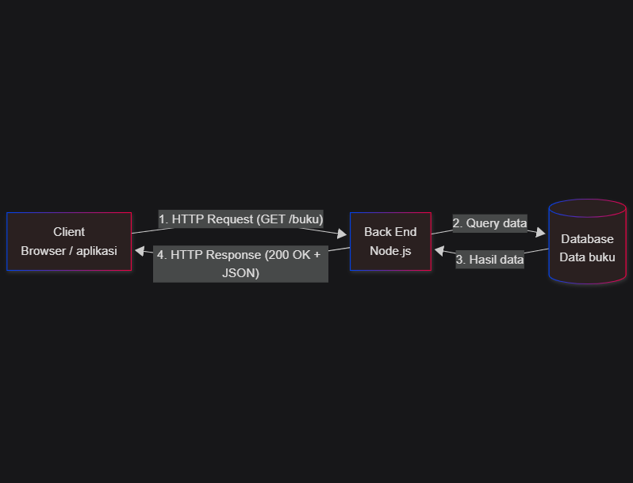

# Tugas 1 - Analisis dan Desain API Perpustakaan

Nama dan NIM: Lintang Azzahra Govarana (240160221021)

## 1. Deskripsi sistem

Sistem perpustakaan kampus ini digunakan oleh dua jenis pengguna, yaitu petugas perpustakaan dan mahasiswa. Petugas dapat menambah buku baru, mengubah data buku, dan menghapus buku. Mahasiswa dapat melihat daftar buku, meminjam buku, dan mengembalikannya. Setiap peminjaman akan mengurangi stok buku, dan buku yang stoknya habis tidak dapat dipinjam.

## 2. Diagram arsitektur



File sumber: diagram.mmd

## 3. Tabel resource dan endpoint

| Resource | Operasi | Method | Endpoint | Request body | Response body | Status sukses / gagal |
|:--|:--|:--|:--|:--|:--|:--|
| buku | Lihat daftar buku | GET | /buku | tidak ada | daftar buku | 200 |
| buku | Lihat detail buku | GET | /buku/:id | tidak ada | satu buku | 200 / 404 |
| buku | Tambah buku | POST | /buku | judul, penulis, tahun, stok | buku baru | 201 / 400 |
| buku | Ubah stok buku | PATCH | /buku/:id | stok | buku yang diubah | 200 / 400 / 404 |
| buku | Hapus buku | DELETE | /buku/:id | tidak ada | tidak ada isi | 204 / 404 |
| peminjaman | Pinjam buku | POST | /buku/:id/peminjaman | tidak ada | data peminjaman | 201 / 400 (stok habis) / 404 |
| peminjaman | Lihat daftar peminjaman | GET | /peminjaman | tidak ada | daftar peminjaman | 200 |
| peminjaman | Kembalikan buku | PATCH | /peminjaman/:id/pengembalian | tidak ada | data peminjaman | 200 / 404 |

## 4. Contoh JSON

### Resource buku

Request body (POST /buku):

```json
{
  "judul": "Belajar Node.js",
  "penulis": "Andi",
  "tahun": 2024,
  "stok": 3
}
```

Response body (201 Created):

```json
{
  "success": true,
  "message": "Buku berhasil ditambahkan",
  "data": {
    "id": 4,
    "judul": "Belajar Node.js",
    "penulis": "Andi",
    "tahun": 2024,
    "stok": 3
  }
}
```

### Resource peminjaman

Request (POST /buku/1/peminjaman): tanpa body, id buku sudah ada di alamat.

Response body (201 Created):

```json
{
  "success": true,
  "message": "Buku \"Belajar Node.js\" berhasil dipinjam, sisa stok: 2",
  "data": {
    "id": 1,
    "bukuId": 1,
    "peminjam": "Mahasiswa (dummy)",
    "status": "dipinjam"
  }
}
```

## 5. Skenario uji

### Skenario 1: pinjam buku berhasil

Request: POST /buku/1/peminjaman (buku id 1 stoknya 3)

Response, status 201 Created:

```json
{
  "success": true,
  "message": "Buku \"Belajar Node.js\" berhasil dipinjam, sisa stok: 2",
  "data": {
    "id": 1,
    "bukuId": 1,
    "peminjam": "Mahasiswa (dummy)",
    "status": "dipinjam"
  }
}
```

### Skenario 2: pinjam buku yang stoknya habis (gagal)

Request: POST /buku/2/peminjaman (buku id 2 stoknya 0)

Response, status 400 Bad Request:

```json
{
  "success": false,
  "message": "Stok buku \"Dasar JavaScript\" habis, tidak dapat dipinjam"
}
```

### Skenario 3: buku tidak ditemukan (gagal)

Request: GET /buku/99

Response, status 404 Not Found:

```json
{
  "success": false,
  "message": "Buku dengan id 99 tidak ditemukan"
}
```