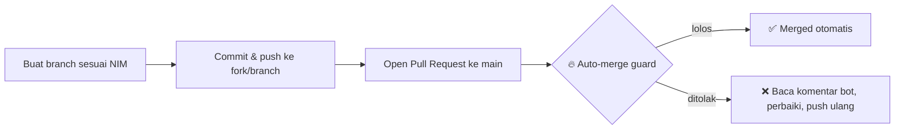

<div align="center">

# 🚀 SI-VB-Backend

**Backend Development — Kirimtec / Kelvin Tech In School**

`2026-2027 Gasal`

[](https://github.com/PBWFEND/SI-VB-Backend/actions/workflows/auto-merge.yml)


</div>

---

## 📊 Statistik Repo

<div align="center">


</div>

## 🗂️ Struktur Repo

```text
SI-VB-Backend/
├── 240160221004/        # Mahasiswa — per pertemuan
├── 240160221005/
├── 240160221019/
├── 240160221034/
├── 240160221035/
├── 240160221045/
├── 240160221055/
├── tugas-2/             # Tugas bersama lintas mahasiswa
├── .github/workflows/   # GitHub Actions (auto-merge)
└── README.md
```

Setiap mahasiswa punya **folder sendiri** (dinamai NIM). Kerjakan tugas per pertemuan, jangan menyentuh folder mahasiswa lain.

## 🔄 Alur Pengumpulan Tugas



PR yang lolos safety check **langsung di-merge otomatis** oleh bot.

### Aturan Auto-merge

| Cek | Limit |
|---|---|
| Base branch | `main` |
| Login GitHub mengandung NIM `2401...` | wajib (atau label `auto-merge`) |
| Jumlah file berubah | ≤ 200 file |
| Total baris terhapus | ≤ 500 baris |
| Menghapus file / menyentuh `README.md`, `.gitignore`, `.github/*` | ❌ ditolak |
| Menyentuh folder mahasiswa lain | ❌ ditolak |
| Commit `node_modules/` | ❌ ditolak |
| Conflict marker `<<<<<<<` / `>>>>>>>` | ❌ ditolak |

Kalau PR ditolak, bot akan menulis komentar di PR berisi **alasan + cara memperbaiki** (mis. perintah `git rm --cached` untuk membersihkan `node_modules`).

> **Jangan commit `node_modules/`** — tambahkan `.gitignore` berisi `node_modules/` di folder masing-masing.

<!-- ALL-CONTRIBUTORS-LIST:START -->

<table>
<tr>
<td align="center">
<a href="https://github.com/PBWFEND/SI-VB-Backend/graphs/contributors">

</a>
</td>
</tr>
</table>

<p align="center">
<a href="#"></a>
<a href="#"></a>
<a href="#"></a>
</p>

<!-- ALL-CONTRIBUTORS-LIST:END -->

---

<div align="center">
<sub>🔒 README ini proteksi repo — perubahan hanya melalui maintainer.</sub>
</div>
