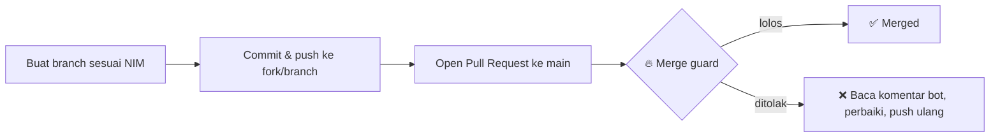

# 🚀 SI-VB-Backend

`2026-2027 Gasal`

---

## 🔄 Alur Pengumpulan Tugas

Pull Request yang memenuhi ketentuan **langsung di-merge**.

### Ketentuan Merge

| No | Ketentuan | Batas |
|----|-----------|-------|
| 1 | Target branch | `main` |
| 2 | Berkas yang diubah | hanya folder NIM penyusun |
| 3 | Penghapusan berkas | tidak diizinkan |
| 4 | Berkas terlindungi (`README.md`, `.gitignore`, `.github/`) | tidak boleh diubah |
| 5 | `node_modules/` dan berkas asing | tidak boleh disertakan |
| 6 | Jumlah berkas berubah | maksimal 200 |
| 7 | Baris terhapus | maksimal 500 |
| 8 | Conflict marker (`<<<<<<<`, `=======`, `>>>>>>>`) | tidak boleh ada |

Pull Request yang belum memenuhi ketentuan tidak di-merge; bot menyertakan alasan beserta langkah perbaikannya pada kolom komentar.

<!-- ALL-CONTRIBUTORS-LIST:START -->

### 👥 Contributors

<table>
  <tr>
    <td align="center">
      <a href="https://github.com/yysofiyan">
         
        <b>Yanyan Sofiyan</b>
      </a> 
      Dosen
    </td>
    <td align="center">
      <a href="https://github.com/RahmaNadya240160221035-source">
         
        <b>Rahma Nadya</b>
      </a> 
      240160221035
    </td>
    <td align="center">
      <a href="https://github.com/cinta-rahmia-yulianti">
         
        <b>Cinta Rahmia Yulianti</b>
      </a> 
      240160221005
    </td>
  </tr>
  <tr>
    <td align="center">
      <a href="https://github.com/PutriIndraa">
         
        <b>Putri Indra Lestari Aryanto</b>
      </a> 
      240160221034
    </td>
    <td align="center">
      <a href="https://github.com/kikan-khairani">
         
        <b>kikan-khairani</b>
      </a> 
      240160221019
    </td>
    <td align="center">
      <a href="https://github.com/kurniaa24">
         
        <b>kurniaa24</b>
      </a> 
      240160221025
    </td>
  </tr>
  <tr>
    <td align="center">
      <a href="https://github.com/Rendi-informatics">
         
        <b>Rendi FS</b>
      </a> 
      240160221037
    </td>
    <td align="center">
      <a href="https://github.com/SitiKhodijah24">
         
        <b>SitiKhodijah24</b>
      </a> 
      240160221045
    </td>
    <td align="center">
      <a href="https://github.com/aprilliana-fratiwi">
         
        <b>aprilliana-fratiwi</b>
      </a> 
      240160221004
    </td>
  </tr>
  <tr>
    <td align="center">
      <a href="https://github.com/Rasya-Putri-R91006">
         
        <b>Rasya Putri Ramadhani</b>
      </a> 
      240160221055
    </td>
    <td align="center">
      <a href="https://github.com/yysBotX">
         
        <b>yysBotX</b>
      </a> 
      Bot/Maintainer
    </td>
  </tr>
</table>

<!-- ALL-CONTRIBUTORS-LIST:END -->

---

🔒 README ini proteksi repo — perubahan hanya melalui maintainer.

